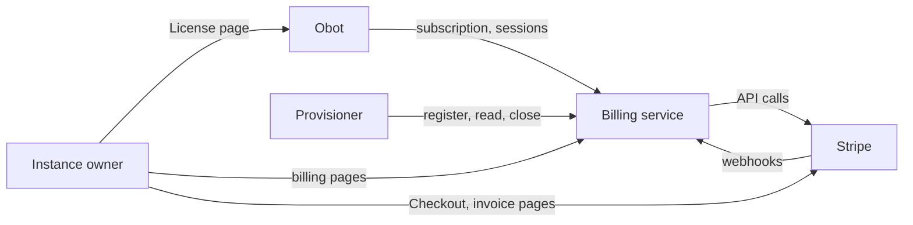

# 2026-09-23: Cloud Billing

- **Authors:** @njhale
- **Created:** 2026-09-23

## Summary

Add subscription billing to Obot Cloud so we can collect recurring payments
for a plan priced per user. Introduces one self-service plan, Standard, whose
devices, memory, CPU, audit log storage and network egress grow with its
users, and an add-on that sells extra memory and CPU. Users with the Owner role
reach billing from their instance's License page to subscribe, change their
users and add-on, update payment details, view invoices, and cancel or resume.

Stripe handles payment. A new shared billing service, obot-billing, owns the
Stripe account and the plan catalog, runs each environment's trial, hosts the
billing pages, and serves each environment's entitlements over HTTP. Inside
Obot, a billing client syncs those entitlements, and with billing configured
they replace the Keygen license as the one source of features and limits. Obot
enforces them itself: it counts the memory and CPU its hosted MCP servers
request and refuses what would exceed the plan, so nothing outside Obot needs
cluster access to enforce a plan. Trials run in the billing service with no
Stripe objects; Stripe sees an environment only once an owner subscribes.

## Related issues

- [obot-platform/obot#8008](https://github.com/obot-platform/obot/issues/8008) —
  Defines the plans, subscription behavior, and environment lifecycle.

## Related ODPs

None.

## Problem and motivation

We want to sell Obot Cloud through a plan that packages entitlements, with a
monthly charge per user and the option to buy more capacity for hosted MCP
servers. We need a way to present the plan, collect payment, and let customers
change what they buy.

Billing also needs to control what the customer's instance allows. The number
of users bought determines how many users can sign in, and how many devices,
how much memory and CPU, and how much audit log storage and egress the
instance gets. The add-on raises memory and CPU. Subscription changes must keep
those entitlements aligned with what the customer is paying for.

## Goals

- Collect recurring per-user payment for Obot Cloud.
- Sell extra memory and CPU for hosted MCP servers as a priced add-on.
- Let instance owners manage their own subscription: see prices, change users
  and the add-on, update payment details, view invoices, and cancel, without
  putting any of that in Obot.
- Make the billing service the only source of an Obot Cloud environment's
  entitlements, including the compute its hosted MCP servers may request.
- Let the provisioner put an environment on a plan sold outside Stripe, such as
  Enterprise, through the same record and the same API.
- Enforce entitlements against existing usage, not only new usage, so an
  environment that exceeds what it pays for is restricted until it fits again.
- Let an owner change their subscription at any time, without first
  rearranging their instance to fit.
- Grant increased entitlements only after payment succeeds.
- Apply subscription changes to the environment without operator action.
- Decide environment cleanup by subscription state.

## Non-goals

- Self-service Enterprise or self-hosted subscriptions. Enterprise remains
  sales-led and billed outside this flow.
- Building payment forms, or handling card details in any Obot or billing
  service code.
- Migrating existing environments to billing.
- Giving the billing service access to any Kubernetes cluster. It states an
  environment's allowance; it creates and manages nothing.
- Metering or charging for compute consumed. The compute allowance is a ceiling
  that refuses, not a meter that bills.
- Enforcing audit log storage or network egress. The plan states them, and Obot
  stores them, but neither is counted yet.
- Capping the number of hosted MCP servers. Memory and CPU bound them instead.

## Context and constraints

**Licensing.** Cloud environments keep their Keygen license key, which still
authenticates the model service. With billing configured, the billing plan
replaces the license as the source of every feature and limit. The two are
never combined.

**Access.** In an Obot instance, users with the Owner role manage the
instance's subscription. Admins and auditors can see it.

**Credentials.** As a security posture, an environment should avoid holding
broadly scoped payment-provider credentials: ones that could act on other
environments' subscriptions or on the payment platform itself.

**Trials.** Every environment gets a Standard trial when it is registered, with
no payment method and nothing in Stripe. The provisioner's environment expiry
still decides when an unconverted environment is redirected and deleted.

**Users, the add-on and compute.** Everything but audit log retention scales
with the users bought. The add-on raises memory and CPU in fixed units.
Retention is fixed by the plan.

**Changes.** User and add-on changes are prorated and apply immediately.
Increases are charged straight away and only take effect once that payment
succeeds; decreases credit the unused part of the period against the next
invoice. Cancelling applies at the end of the billing period, and can be
withdrawn until then.

**Downgrades.** An owner can move to fewer users or add-on units at any time,
without first reducing what the instance is using. If the environment then
exceeds what it pays for, it is restricted until it fits. Lower retention
deletes older audit logs at the next cleanup, and raising it again doesn't
bring them back.

**Enforcement.** Entitlements are enforced against existing usage, not only
against new usage, and nothing is deleted to make an installation fit.

**Ending.** Cancelling isn't deleting. When a subscription ends, the
environment keeps its limits for a grace period, then is redirected and later
deleted by the provisioner. An environment with a live subscription is never
redirected or deleted by the nightly job.

**Outages.** A billing outage isn't a downgrade. The environment keeps its last
known entitlements, including across restarts, and isn't redirected or deleted.

## Proposed design

Self-service subscriptions bring together four components, each owning one
thing:

- **Stripe** owns money: the subscriptions themselves, Checkout, the hosted
  invoice pages, and the Payment and Address Elements that collect card and
  billing details on the billing pages.
- **The billing service**, new and shared by Cloud environments, owns the
  Stripe account and the plan catalog. It is the only component holding Stripe
  credentials. It runs trials, maps each environment to a Stripe customer and
  subscription once the owner subscribes, keeps a copy of that state, computes
  entitlements from the catalog, and hosts the billing pages.
- **Obot** owns enforcement. Its billing client syncs the environment's
  subscription and entitlements and stores them; Obot counts its own usage,
  applies the limits, restricts the instance when it stays over them, and shows
  the License page. It never sees a Stripe object.
- **The provisioner** owns the environment lifecycle and its infrastructure.
  Its Terraform creates each environment's billing key; it registers the
  environment, keeps paying environments out of the nightly cleanup, and closes
  billing before deleting an environment.

Entitlements travel in one direction: Stripe notifies the billing service,
which updates its copy and serves it to Obot, which stores it and enforces it.



### Billing model

#### Environments, customers and subscriptions

Each environment gets its own Stripe customer, created the first time an owner
subscribes, and at most one live subscription. All of that environment's
owners manage it. A person managing several environments therefore has
separate payment details and invoices for each.

#### The plan and the add-on

The catalog is part of the billing service's code, not Stripe metadata. It
names each plan, its user range, its entitlements and its add-ons, and refers
to Stripe prices by lookup key. Stripe holds only the prices.

**Standard** is charged per user per month, for 1 to 300 users, 5 by default.
The 300 user cap isn't advertised.

| Entitlement               | Each user adds | Baseline (unadvertised) |
| ------------------------- | -------------- | ----------------------- |
| Users                     | 1              | 0                       |
| Devices                   | 1              | 0                       |
| Memory                    | 256 MiB        | 1.6 GiB                 |
| CPU                       | 63 millicores  | 1.5 cores               |
| Audit log storage         | 1 GiB          | 0                       |
| Network egress            | 3 GiB a month  | 0                       |
| Audit log retention       | 30 days, fixed |                         |
| Enterprise auth providers | Included       |                         |

The baseline means even a single user can run hosted MCP servers. Audit log
storage and network egress are stated but not enforced. Remote MCP servers and
the number of hosted MCP servers aren't limited.

**Extra memory and CPU** is the add-on, charged per unit per month. Each unit
adds 1 GiB of memory and 0.25 cores, from 0 to 100 units. The 100 unit cap
isn't advertised.

A subscription has one item for the plan, whose quantity is the number of
users, and one item for the add-on while it has units. An add-on taken to zero
is deleted rather than left at zero.

**Enterprise** has no price and no seats. The provisioner puts an environment
on it, with whatever entitlements were agreed.

To change a price, we add a new one in Stripe and move the lookup key to it.
New subscriptions get the new price; existing subscribers keep theirs, and
their items still map to the plan through the price's product. Changing what a
plan grants is a catalog change, which takes effect for each environment the
next time what it bought changes.

At startup the billing service checks that every lookup key resolves to an
active, licensed, per-unit monthly price in one currency, and refuses to start
otherwise. A price that billed differently than the catalog assumes would
charge customers for something other than what they get.

#### Entitlements

The billing service computes entitlements when what an environment bought
changes: the plan's baseline, plus each user's and each add-on unit's
additions, with users set to the number bought. Quantities come from the
subscription items, never from invoice lines: a quantity change credits the
old line and creates a new one, so invoice lines don't describe what the
customer has now.

A trial carries Standard at 5 users. There is no separate trial tier.

Entitlements are one flat object: features are booleans, and limits are
numbers or `null` for unlimited. The billing service and Obot share this shape,
so nothing is translated in between:

```json
{
  "enterpriseAuthProviders": true,
  "enterpriseModelProviders": false,
  "users": 5,
  "devices": 5,
  "memoryMiB": 2918,
  "cpuMillicores": 1815,
  "auditLogRetentionDays": 30,
  "auditLogStorageMiB": 5120,
  "networkEgressMiB": 15360
}
```

Inside Obot, the Keygen license is read into the same typed struct, through one
mapping from its entitlement codes. Features are gated on the same paths
whichever source supplied them. Limits are absolute: two sources are never
added together, and a ceiling like memory has no meaning as a sum.

The compute allowance is what an environment's hosted MCP servers may request
in total. It is a number the billing service states and Obot enforces; the
billing service creates no Kubernetes object and holds no cluster credential.
Terraform keeps a namespace `ResourceQuota` on billing environments only as a
safety net, set above the most Standard can grant (1.6 GiB plus 300 users and
100 add-on units, about 177 GiB), so Obot's accounting is what a plan is held
to.

Retention is read on every cleanup pass instead of once at startup. A plan's
retention above 0 replaces the configured one, capped at 100 years; 0 keeps the
configured retention.

#### Subscription states

The billing service reports one of four states. The mapping is exhaustive over
Stripe's
[subscription statuses](https://docs.stripe.com/billing/subscriptions/overview):

| Billing state | Comes from                                       | Environment behavior |
| ------------- | ------------------------------------------------ | -------------------- |
| `trialing`    | A trial the billing service runs                 | Live, on Standard at 5 users, until the trial ends. Follows the provisioner's expiry. |
| `active`      | Stripe `active` or `trialing`                    | Live, with what it bought. Not redirected or deleted. |
| `pastDue`     | Stripe `past_due`                                | Live, with what it bought, while Stripe retries. Not redirected or deleted. |
| `ended`       | Any other Stripe status, or a trial past its end | Ended. See below. |

A trial that ends drops its counted limits (users, devices, memory, CPU, audit
log storage and egress) to 0 straight away, keeping its features and
retention. A subscription that ends keeps its limits for a 3-day grace period,
then drops them the same way. Stripe's `incomplete`, `unpaid` and `paused`
statuses count as ended; a subscription revived from them, by paying or
resuming, is synced back to live.

Stripe is configured to retry a failed renewal within 3 days and then cancel
the subscription, so `pastDue` is bounded and an unpaid subscription ends
rather than lingering.

### End-to-end flows

#### Provisioning and registration

1. A provision request sets `billing=true`, which the provisioner accepts only
   for shared environments, and only when billing is configured. The job writes
   `billing_enabled = true` into the environment's Terraform workspace.
2. The workspace generates a random **billing key** once, passes it to Obot as
   `OBOT_SERVER_BILLING_KEY`, and outputs only its SHA-256 hash. Obot reaches
   billing at its default address, `https://billing.obot.ai`.
3. After the last apply, a `register_billing` step sends the environment ID,
   the verified contact email, the canonical environment URL and the key hash
   to the billing service's `POST /api/v1/register`, with the provisioner
   token.
4. The billing service records the environment and starts its trial. Nothing
   is created in Stripe. Registration is idempotent on the environment ID: a
   retry with the same key hash changes nothing, and a different key hash is
   refused, since the running Obot holds the original key.
5. Obot's leader syncs its subscription from `GET /api/v1/subscription`. Until
   billing first answers, no plan applies: every feature is on, nothing is
   limited, and the instance is never restricted. The License page says it is
   waiting for billing.
6. The provisioner sends the activation email. The owner signs in to a
   Standard trial and can see its end date on the License page.

The registration request:

```json
{
  "id": "env-3f9c2a01",
  "email": "owner@example.com",
  "url": "https://env-3f9c2a01.obot.ai",
  "billingKeyHash": "9f86d081884c7d659a2feaa0c55ad015a3bf4f1b2b0b822cd15d6c15b0f00a08"
}
```

`trialEnd`, `plan` and `entitlements` are optional. With `plan`, which must be
a plan the provisioner sets, the environment starts active on it instead of
trialing; `entitlements` replace the ones it starts with.

#### The trial

The billing service runs trials itself, for 7 days from registration. Every
replica ends expired trials each minute. An owner who doesn't subscribe keeps
the instance, at zero users' worth of limits, until the provisioner's expiry
redirects it.

The provisioner's environment lifetime is unchanged and still drives what
happens to an unconverted environment: it warns 3 days before expiry,
redirects at expiry, and deletes 14 days after that. Moving a billing
environment's expiry later first moves its trial's end in billing, so extending
an environment extends its trial too.

#### Synchronizing entitlements

The billing service keeps a copy of each environment's Stripe subscription. It
syncs from Stripe after each verified webhook, after each page action, and in
a sweep every 15 minutes that catches missed events and Dashboard edits. A
webhook only starts a sync; the state always comes from Stripe's API.

Obot's leader syncs `GET /api/v1/subscription` every 15 minutes, every 5 after
a failure, and when an admin clicks **Check now** on the License page, which
is how a change made on the billing pages appears once the owner returns. It
stores the answer in a `BillingSubscription` object that every replica reads,
and keeps the last answer across failed syncs and restarts.

#### Subscribing

1. The owner selects **Manage billing** on the License page. Obot checks the
   Owner role and opens a session with `POST /api/v1/sessions`, passing a
   return URL on the environment's registered host. Billing answers with a
   one-time link, which Obot opens in a new tab, or on the same page when the
   browser blocks it.
2. The link works once, within 5 minutes. Billing trades it for a 30-minute
   session cookie and redirects to its pages, so the address the owner keeps
   carries no secret.
3. The plans page shows Standard as a card, and its configure page sets the
   users and add-on units, showing what they include and a monthly estimate.
4. Billing creates the environment's Stripe customer if it has none, expires
   its other open Checkouts, checks it has no live subscription, and sends the
   owner to Stripe Checkout for the chosen users and units. The environment's
   lock is held throughout, so two forms can't both leave a Checkout open.
5. Checkout collects the card and starts the subscription, charging the first
   period at once. Any remaining trial days are dropped.
6. The owner returns to billing, which reads the Checkout from Stripe rather
   than trusting the URL, syncs, and sends them back to Obot.

An environment whose subscription has ended subscribes the same way.

#### Changing a subscription

An owner can change their subscription whenever they like. Nothing has to be
rearranged in the instance first, and no change is refused because of current
usage.

1. The owner picks new users and add-on units on the configure page.
2. A confirm page shows Stripe's own preview of the prorated amount due now
   and what each period will cost from then on, as of a proration date the
   confirm form carries back. A preview older than 10 minutes is refused, so
   the amount charged is the amount shown.
3. On confirm, billing changes every item in one call: the plan item to the
   chosen users, and the add-on item to its units, deleting it at zero. A
   confirm page submitted twice changes nothing the second time.
4. Back on the License page, Obot syncs. If usage is now over a limit, the
   page says so and when the instance will be restricted.

Sessions are single-use, expire after a short interval, and their tokens are
stored only as hashes.

**Proration and payment.** Increases are invoiced and charged immediately and
held [pending](https://docs.stripe.com/billing/subscriptions/pending-updates)
until that invoice is paid, so a declined or unauthenticated card leaves the
old entitlements in place. Decreases prorate the other way: the unused part of
the period becomes a credit on the customer's balance that comes off the next
invoice. No money is refunded, and a subscription cycled down and back up nets
out.

#### Payment failures

1. A renewal fails. The subscription becomes `pastDue` and keeps its
   entitlements while Stripe retries, sending its failed-payment emails.
2. The billing pages show the due invoice, linking to Stripe's hosted invoice
   page, so the owner can pay it from **Manage billing**.
3. If the last retry fails, within 3 days, Stripe cancels the subscription. It
   keeps its limits for the 3-day grace period, then drops them, and the
   provisioner redirects the environment.

#### Payment details, invoices and cancelling

These are billing service pages, reached through the same session. Obot has no
invoice, payment method or cancellation concepts.

**Payment method and billing details** are updated in place with Stripe's
Payment and Address Elements, through a Checkout Session in setup mode. Only
those pages load Stripe.js. A saved card becomes the default of both the
customer and the subscription, because Stripe charges the subscription's
default first.

**Invoices** are listed from Stripe, each linking to its hosted invoice page
and PDF. Those links expire, so they are fetched when the page is rendered.

**Cancel** takes effect at the end of the period and can be withdrawn until
then. After that the subscription is over, and returning means subscribing
again.

#### Enforcing the compute allowance

Obot measures hosted usage from what it has stored, not from a running total
of what it believes it created: the memory and CPU requested by the servers its
vMCPs and vMCP instances run, under the current K8s settings. A container's
limit counts when it sets no request, as Kubernetes does. A count taken from
what exists cannot drift, survives a restart, and makes a redeployment of an
unchanged server cost nothing, because that server is already in the count.

The embedded storage API server checks every create and update of those kinds,
patches included, whichever client makes it: API handlers, controllers such as
the catalog sync, and connections that start servers. Under one Postgres
advisory lock it reads the plan, counts usage, and makes the write, so two
replicas cannot both admit the last of the allowance. It refuses only a write
that raises usage past a limit, with a 402 that names the limit; a write that
lowers usage always goes through. An MCP client whose connection wouldn't fit
gets the reason as a JSON-RPC error, and no server starts.

Users and devices are limited where they are created, as they are today.

#### Restricted mode

Obot's leader recounts usage at each sync and whenever vMCPs, vMCP instances or
the K8s settings change. The environment is restricted when either:

- usage has stayed over any limit for 3 days, which gives an owner time to
  adjust after a downgrade or the end of a trial; or
- billing has been unreachable for 3 days past the last known period end,
  which keeps an outage at renewal, before billing confirms the new period,
  from restricting a paid environment.

| Who               | What they can do while restricted |
| ----------------- | --------------------------------- |
| Owners and admins | Everything, including through their scoped API keys, so they can get back under the limits or change the subscription |
| Everyone else     | Signed out; their page loads go to the login page, which says why |
| Their MCP clients | Refused with the reason as a JSON-RPC error |
| Devices           | Keep reporting |

The instance leaves restricted mode once it fits again, whether users and
servers were removed or the owner bought more. Nothing is deleted or evicted to
make it fit: servers a downgrade leaves over the allowance keep running, and
deleting them stays available throughout.

This is what allows subscription changes to be unconditional. It applies
however an environment comes to exceed its limits: a downgrade, the end of a
trial or subscription, or an edit in the Stripe Dashboard.

Messages and pages members see name the limit without usage numbers. Usage,
the subscription and sync errors are shown to admins and auditors only.

#### Closing and deleting an environment

Each night, before redirecting or deleting anything, the provisioner reads each
billing environment's state from `GET /api/v1/environments/{id}`. It leaves an
environment alone while billing reports it `active` or `pastDue`, for the
3-day grace period after its subscription ended, and while billing can't
answer. A trialing or ended environment otherwise follows the usual expiry.
Manual exemptions are honored.

Deprovisioning starts with a `close_billing` step, before anything is
destroyed, which calls `POST /api/v1/environments/{id}/close`. The billing
service expires open Checkouts first, so none completes after the cancel, then
cancels the environment's subscriptions, voids what's still due, and closes the
environment for good. A Stripe failure rolls everything back and the step is
retried; if closing keeps failing, the job stops with the environment intact.
An environment billing doesn't know counts as closed.

### Billing service contract

#### Authentication and stored state

Following the credentials posture in
[Context and constraints](#context-and-constraints), the billing service holds
a restricted Stripe API key, so individual instances never receive access to
our Stripe account. It refuses live secret keys outright.

The billing key is a deployment secret generated by the environment's Terraform
workspace. Obot uses it to authenticate to the billing service, which stores
only its hash and uses it to identify the environment on every request. The
provisioner uses a separate provisioner token, compared in constant time, which
grants registration, reads and close across environments.

The billing service stores, in PostgreSQL, one row per environment, holding
its key hash, plan, users, add-on units, status, trial and period dates,
entitlements and Stripe IDs, plus a sessions table. It stores only hashes of
keys, tokens and cookies. Every change holds the environment's row lock, so
replicas can run side by side with no leader.

#### API

Billing service, JSON under `/api/v1`:

| Endpoint | Caller | Authentication | Purpose |
| --- | --- | --- | --- |
| `POST /register` | Provisioner | Provisioner token | Register or update an environment and start its trial, or put it on a provisioner-set plan. Idempotent. |
| `GET /environments/{id}` | Provisioner | Provisioner token | The environment's plan, status, users, add-ons, entitlements and dates. |
| `POST /environments/{id}/close` | Provisioner | Provisioner token | Cancel everything in Stripe and close the environment for good. |
| `GET /subscription` | Obot | Billing key | This environment's plan, status, period end, cancellation, whether payment is required, whether it is self-service, and its entitlements. |
| `POST /sessions` | Obot | Billing key | Open a one-time link to the billing pages. |
| `POST /stripe/webhook` | Stripe | Verified signature | Queue a sync of the event's environment. |

The billing pages live under `/manage`, behind the session cookie. Every form
is checked against the session's environment, and the pages send a strict CSP,
opened to Stripe only on the pages that load its Elements.

The subscription Obot reads:

```json
{
  "plan": "Standard",
  "status": "active",
  "periodEnd": "2026-12-03T00:00:00Z",
  "cancelAtPeriodEnd": false,
  "paymentRequired": false,
  "selfService": true,
  "entitlements": { "users": 20, "devices": 20, "...": "..." }
}
```

#### Obot configuration

Obot gets two settings, both hidden:

- `OBOT_SERVER_BILLING_KEY`: the environment's billing key. Setting it turns
  billing on.
- `OBOT_SERVER_BILLING_URL`: the billing service's address, by default
  `https://billing.obot.ai`.

Without a billing key, Obot behaves exactly as it does today.

#### Changes in Obot

- **One entitlement source.** A typed entitlements struct of features and
  limits. At startup, services pick the source: the Keygen license or the
  billing plan.
- **Billing state.** A billing client and a leader-only controller that syncs
  the `BillingSubscription`, recounts usage and decides restriction.
- **Hosted usage.** A measure of what hosted MCP servers request, and a limiter
  the embedded storage API server applies to every write of the counted kinds.
  It replaces the existing capacity check against a namespace `ResourceQuota`'s
  headroom, which didn't account for a running server's own request already
  being counted, so re-applying an unchanged server could be refused near the
  limit.
- **Restriction.** The request gate signs out and refuses restricted users, and
  answers their MCP clients with a JSON-RPC error.
- **Retention.** The audit log cleanup reads its retention on every pass, and
  only the leader runs it.
- **API.** `GET /api/license` returns the entitlements as an object, and with
  billing the subscription, usage and sync error for admins and auditors.
  `POST /api/license` starts a sync, and `POST /api/license/manage` opens the
  billing pages for owners. The Keygen-only license routes are off with
  billing.
- **License page.** With billing, it shows the plan, its status and period,
  each limit as "x of y" against usage, and the audit log retention; an
  owner-only **Manage billing** button; **Check now**; and banners when the
  environment is over its plan or restricted. It has no prices, invoices,
  payment methods or cancellation of its own.

## Alternatives considered

### Stripe Customer Portal

Stripe's hosted portal would replace the billing pages, but it cannot change a
subscription with more than one item, so it can't manage the add-on, and it
cannot make a change conditional on payment.

### Stripe trials

A trial could be a Stripe subscription with a trial period and no payment
method, so converting only adds a card. Rejected: every environment would need
a Stripe customer and subscription at registration, including the many that
never pay, registration would make Stripe calls that have to be idempotent, and
a Stripe outage would block provisioning. Running trials in the billing service
keeps Stripe out of the path until an owner decides to pay.

### Plan definitions in Stripe metadata

Plans and their entitlements could live on Stripe products, editable in the
Dashboard. Rejected: what an environment is entitled to would then change with
an unreviewed Dashboard edit, and a typo in a limit would grant unlimited use.
The catalog is reviewed code that the service validates strictly at startup,
and Stripe holds only prices.

### Several plans

Team and Business plans, with fixed hosted MCP server counts and a server
add-on, were considered first. Rejected in favor of one plan that scales with
users: it is simpler to sell and to change, an owner never has to move between
plans to grow, and memory and CPU track what hosted servers cost to run better
than a count of servers.

### Encoding limits as license entitlement names

The billing client could turn numbers into Keygen-style names, like
`OBOT_20_USERS`, and reuse the license parsing. Rejected: names are summed when
several match, which is wrong for a ceiling like memory, and a typed struct
keeps the license and plan checks from drifting apart.

### Enforcing compute in API handlers

Obot could check the allowance in each handler that creates a server.
Rejected: controllers, nah's apply and patches write those objects too, and
wrapping the API's client missed controller writes. Checking in storage covers
every client.

### Refusing a downgrade until the environment's usage fits

Obot could refuse a change that would leave the environment over its limits.
Rejected: it requires an owner to tidy their instance before being allowed to
pay less, and it would not remove the need for restricted mode, since usage
drifts above the limit for reasons a check at purchase time never sees.

### Per-environment Keygen licenses

Rejected. Every shared Cloud environment is provisioned from one template with
one shared license key, so per-environment entitlements would mean a distinct
license secret per environment, created and destroyed with it.

### Billing in the provisioner

Reuses environment identity and an existing deployment, but puts
customer-facing billing APIs alongside infrastructure authority.

### Instances call Stripe directly

Avoids a service, but every instance would hold a Stripe key that can reach
every customer, and would need Stripe's webhooks, which carry every customer's
events.

## Trade-offs

### A separate billing service

Stripe keys and webhooks stay out of instances, and Obot has no Stripe code. In
return, we run another service and it becomes customer-facing. Provisioning
registers with it, so a billing outage holds up new billing environments.

### Building the billing pages

We build and maintain them, and their availability and appearance become
customer-visible.

### Restricted mode is all or nothing

An instance one user over its limit stops serving every non-administrator, not
just the extra user. This avoids a rule for deciding who keeps access, at the
cost that an owner who ignores the warnings loses the instance for everyone
else until they fix it. The 3-day grace softens this.

### Every feature on before billing first answers

A new environment works immediately, rather than waiting on billing to become
ready. In return, an environment whose billing never answers runs unlimited.
Registration happens before the activation email, so billing normally knows the
environment before its first sync.

### One Stripe customer per environment

Each environment's billing is separate, and its owners manage only that
environment's subscription. An owner of several environments has separate
payment details and invoices for each.

## Risks and open questions

- **Trial and expiry lengths differ.** Billing's trial lasts 7 days, while the
  provisioner's environment expiry defaults to 14. An unconverted environment
  drops to zero limits on day 7, is restricted on day 10, and is redirected on
  day 14. Registering with the expiry as the trial's end would align them.
- **Undoing a redirect.** A redirected environment stays redirected, and its
  owners reach billing only through Obot, so resubscribing can't bring it back
  yet.
- **Monitoring paying environments.** Billing environments get an uptime
  monitor only when they are also `customer` or `managed_poc`. Billing has no
  callback to tell the provisioner about subscription changes; the provisioner
  asks during its nightly run.
- **Audit log storage and network egress** are stated per user but not counted
  or enforced.
- **Before paying customers:** idempotent customer creation, rotatable
  credentials, an audit log, metrics and alerts in the billing service.

## Rollout and migration

1. Create the products and prices with their lookup keys, the webhook
   endpoint, and the failed-payment settings in Stripe.
2. Deploy the billing service in `chat-obot`, with its own database on the
   existing Cloud SQL instance, and point `billing.obot.ai` at it.
3. Release Obot with the billing client, the storage limiter, restricted mode
   and the License page. Billing stays off until a billing key is set.
4. Release the provisioner and Terraform changes. Billing stays off in the
   provisioner until `BILLING_URL` is set, and only requests with
   `billing=true` use it.

Existing environments aren't migrated. Environments provisioned without
`billing=true` are unchanged.

To roll back, stop sending `billing=true`. Billing environments already
provisioned keep reading billing; removing their billing key returns them to
their license key's limits. Existing subscriptions keep billing in Stripe until
they are cancelled or the environment is closed.

## Testing and validation

Unit and PostgreSQL integration tests in the billing service run against a
local Stripe fake. End-to-end tests run in a kind cluster with 3 Obot replicas
against the billing service and a Stripe sandbox.

### Provisioning and trials

- Register an environment. Verify a trialing Standard at 5 users, nothing in
  Stripe, and the trial's end on the License page.
- Register again with the same key hash and with a different one. Verify the
  first changes nothing and the second is refused.
- Move an environment's expiry later. Verify the trial's end moves to match.
- Let a trial end. Verify the counted limits drop to 0, the environment is
  restricted after 3 days, and the provisioner's redirect is unchanged.

### Subscribing and changing

- Subscribe during a trial through Checkout. Verify one customer, one active
  subscription, and the new entitlements after returning to Obot.
- Open two Checkouts and complete both. Verify only one subscription exists.
- Change users and add-on units up and down. Verify the confirm page's amount
  matches the invoice, proration in Stripe, and the new entitlements.
- Take the add-on to zero and back. Verify the item is deleted and re-added.
- Drive an increase whose payment fails. Verify entitlements don't increase
  and the change stays pending.
- Cancel, resume before the period ends, then cancel and let it end. Verify
  the limits are kept for 3 days and then dropped.
- Save a card and billing details through the Elements. Verify they become the
  customer's and the subscription's defaults.

### Enforcement and restricted mode

- Create and update hosted servers past the memory and CPU allowance, from the
  API, a controller, a patch and an MCP connection. Verify each is refused
  with a 402 naming the limit, and that writes lowering usage go through.
- Race creates from two replicas for the last of the allowance. Verify only
  one is admitted.
- Take an environment over a limit by downgrading and by adding usage. Verify
  it is restricted after 3 days, members are signed out and refused at sign-in,
  their MCP clients get the reason, admins and owners keep full access, and
  devices keep reporting.
- Verify restricted mode lifts once the instance fits, by removing usage and by
  buying more, and that nothing was deleted.
- Make billing unreachable past the period end and recover. Verify restriction
  after 3 days and recovery once billing answers.
- Verify only owners can open billing, and one environment's billing key can't
  read or manage another.

### Deletion

- Deprovision an environment. Verify its Checkouts are expired, its
  subscription is cancelled, its open invoices are voided, and a Stripe failure
  stops the job with the environment intact.

### Failures and rollback

- Fail Stripe and the billing service separately, and restart Obot. Verify
  entitlements are kept and no paying environment is redirected or deleted.
- Provision without `billing=true`. Verify the environment runs on its license
  key as it does today.

## References

- Implementation:
  [obot-platform/obot-billing#1](https://github.com/obot-platform/obot-billing/pull/1),
  [obot-platform/obot#8355](https://github.com/obot-platform/obot/pull/8355),
  [obot-platform/obot-provisioner#34](https://github.com/obot-platform/obot-provisioner/pull/34),
  [obot-platform/terraform#56](https://github.com/obot-platform/terraform/pull/56)
- [Stripe subscription statuses](https://docs.stripe.com/billing/subscriptions/overview)
- [Prorations](https://docs.stripe.com/billing/subscriptions/prorations)
- [Pending updates](https://docs.stripe.com/billing/subscriptions/pending-updates)
- [Set product or subscription quantities](https://docs.stripe.com/billing/subscriptions/quantities)
- [Payment methods on subscriptions](https://docs.stripe.com/billing/subscriptions/payment-methods-setting)
- [Smart Retries](https://docs.stripe.com/billing/revenue-recovery/smart-retries)
- [Hosted invoice page](https://docs.stripe.com/invoicing/hosted-invoice-page)
- [Create a preview invoice](https://docs.stripe.com/api/invoices/create_preview)
- [Customer Portal limitations](https://docs.stripe.com/customer-management/portal-deep-links)
- [Stripe Checkout](https://docs.stripe.com/payments/checkout)
- [Payment Element](https://docs.stripe.com/payments/payment-element)
- [Subscription webhooks](https://docs.stripe.com/billing/subscriptions/webhooks)
