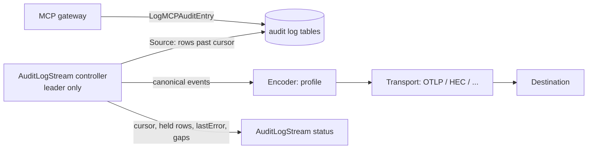

# 2026-10-08: Audit log streaming

- **Authors:** @strelok89
- **Created:** 2026-10-08

## Summary

Add optional audit log streams that continuously deliver Obot's persisted audit events to
external systems: LLM observability tools such as Langfuse, and SIEMs such as Splunk. A
leader-run controller reads new rows past a stored cursor, converts them to a versioned
canonical event, encodes them with a destination profile, and sends them over a transport. The
cursor advances only after the destination accepts a batch, and each event is sent once.

Destinations differ along three independent axes, which the design keeps separate:

- **Source:** MCP audit rows in this proposal; LLM gateway and local-agent rows later.
- **Profile (encoding):** `langfuse`, `otel`, `obot-json`; OCSF later.
- **Transport:** OTLP/HTTP (traces or logs), Splunk HEC; generic HTTPS JSON and syslog later.

Langfuse is `transport: otlp, signal: traces, profile: langfuse`. Streams are off by default,
never run in the gateway request path, and send request/response bodies only when an Auditor
enables it.

## Related issues

- [obot-platform/obot#8183: Stream MCP audit logs to Langfuse](https://github.com/obot-platform/obot/issues/8183)

## Related ODPs

None.

## Problem and motivation

Obot's audit logs hold what both LLM observability tools and SIEMs need: who called which
tool, with what arguments, what came back, and how long it took. Today the data leaves Obot
only as JSONL files in object storage
([audit log export](https://docs.obot.ai/configuration/audit-log-export/)), so every team that
wants it elsewhere writes and operates its own job. That job has to:

- read bodies through `/api/mcp-audit-logs/detail/{id}` one row at a time, because list
  responses always omit them (`pkg/api/handlers/mcpgateway/auditlog.go`, `ListAuditLogs`);
- hold an Auditor API key, since only Auditors may read bodies;
- handle the request/response merge, retries and its own cursor, because scheduled exports
  cover time windows and track no position.

Requests for this come in two shapes: AI observability (#8183, Langfuse) and SIEM
integration (Splunk, Sentinel and others). The core mechanism, delivering audit events as a
stream, is the same.

Obot's OpenTelemetry export (`pkg/otel/otel.go`) does not fill the gap: the only spans are
`otelhttp` server spans named by route pattern, with no tool, user, session or payload.

## Goals

- New audit events reach the destination within about a minute of being persisted, without
  any external job.
- One controller, cursor and canonical event serve every destination; adding a destination
  means adding an encoder or a transport, not another pipeline.
- Each event is sent once and carries a stable event ID. No event is skipped silently, and
  delivery correctness never depends on the destination deduplicating. Any gap is reported on
  the stream's status.
- A destination outage or misconfiguration never affects MCP traffic.
- Shipping request/response bodies requires the same privilege as exporting them today.

## Non-goals

- **Other sources in the first implementation.** LLM gateway rows (Langfuse `generation`
  observations with model, tokens and prompts) and local-agent rows (which carry hostnames,
  working directories and git metadata, so need their own privacy review) are follow-ups. The
  source interface and per-source cursor are designed for them now.
- Linking an MCP tool call to the LLM request that caused it. Obot has no shared trace context
  between the two today.
- Recording the user's email at call time. Rows store only the Obot user ID (see
  [User identity](#user-identity)).
- Backfilling records older than the retention window, or reading data back from a
  destination.

## Scope of the first implementation

| Piece | First implementation | Later |
|---|---|---|
| Source | MCP rows | LLM gateway, local agent |
| Canonical event | `obot.audit.v1` | new versions as sources are added |
| Transport | OTLP/HTTP, `signal: traces` | OTLP `signal: logs` (included if small, otherwise a follow-up); Splunk HEC (Obot team); HTTPS JSON; syslog |
| Profile | `langfuse` (traces) | `otel` (traces and logs), `obot-json` (HEC, HTTPS), OCSF |

The author implements the first column. The interfaces, spec and status below are meant to
support the later column without schema changes.

## Context and constraints

- **Write path.** `LogMCPAuditEntry` (`pkg/gateway/client/auditlogpersister.go`) runs on every
  replica, encrypts bodies and buffers entries; the persistence loop flushes every
  `OBOT_SERVER_MCPAUDIT_LOG_PERSIST_INTERVAL_SECONDS` (default 5). A failed batch is re-queued.
- **Rows change after insert.** `insertMCPAuditLogs` (`pkg/gateway/client/mcpauditlog.go`)
  inserts a request row with `response_received = false` and later merges the response entry
  into it. The table has `created_at` but no `updated_at`, and the gateway sets no per-call
  timeout on proxied calls (the gateway handler builds its client with
  `HTTPClientForServer` and no `Timeout`, `pkg/api/handlers/mcpgateway/handler.go`), so a
  long-running call keeps its row incomplete for as long as the call runs.
- **Export subsystem.** `AuditLogExport` and `ScheduledAuditLogExport` are storage types;
  credentials live in the gateway credential store; `StorageProvider` is object-store only
  (`Test`, `Upload`). Export filters are `AuditLogExportFilters`
  (`apiclient/types/auditlogexport.go`).
- **Leader election.** Controllers run on the elected `obot-controller` leader, with the lock
  in Postgres (`adr/2026-09-02-sql-leader-lock.md`).
- **Body access.** Only Auditors can read or export bodies
  (`auditlog.go`, `canAccessFullPayload = req.UserIsAuditor()`).
- **User identity.** Audit rows store the Obot user ID only; email is resolved through the
  gateway user store (`UserByIDIncludeDeleted` in `pkg/gateway/client/user.go`, so rows from
  deleted users still resolve).
- **Destinations do not deduplicate.** Langfuse v4 does not reliably deduplicate a re-sent span
  ID ([custom ingestion migration
  guide](https://langfuse.com/integrations/native/opentelemetry/migration-to-v4): "Re-ingesting
  the same ID can create duplicate observations"). Splunk HEC, syslog and most SIEMs store
  every event they receive.
- **Langfuse ingestion.** The legacy `POST /api/public/ingestion` API is deprecated and stops
  accepting trace and observation events on Langfuse Cloud on 2026-11-16; the replacement is
  `POST /api/public/otel/v1/traces` (OTLP over HTTP, JSON or protobuf, gzip supported, no
  gRPC). Langfuse stores traces only. Self-hosted deployments need Langfuse v3.22.0 or later.

## Proposed design

### Components



### `AuditLogStream` storage type

Next to `AuditLogExport`. Langfuse:

```yaml
spec:
  displayName: Langfuse
  enabled: true
  source: mcp                      # mcp only in the first implementation
  filters:                         # AuditLogExportFilters
    operations: [tools/call]
  profile: langfuse
  transport:
    type: otlp
    otlp:
      endpoint: https://langfuse.example.com/api/public/otel/v1/traces
      signal: traces
      compression: gzip
    tls:
      caBundle: ""                 # optional PEM for private CAs
  identity:
    destinationUser: email         # email (default) | userID
  withRequestAndResponse: false    # Auditor-only to set true
  maxBodyBytes: 262144             # truncate larger bodies, mark as truncated
  responseTimeout: 30m             # how long to hold a row waiting for its response
status:
  cursor: {mcp: 12345}             # per source: every row at or below is sent, held or lost
  held: [12301, 12322]             # rows below the cursor still waiting for their response
  lastSentAt: ...
  lastError: ""
  gaps: []                         # windows lost to retention while the stream was failing
```

Splunk HEC, which the same type supports without schema changes:

```yaml
spec:
  source: mcp
  profile: obot-json
  transport:
    type: splunk-hec
    splunkHEC:
      endpoint: https://splunk.example.com:8088/services/collector/event
      index: obot
      sourcetype: obot:audit
    tls:
      caBundle: |
        -----BEGIN CERTIFICATE-----
        ...
```

Each transport declares which profiles it accepts, and the API rejects other combinations:
OTLP traces accepts `langfuse` and `otel`; OTLP logs accepts `otel`; HEC and HTTPS JSON accept
`obot-json` (and OCSF later).

An installation may define several streams, each with its own cursor.

Credentials (Langfuse public and secret key, HEC token, OTLP headers) live in the gateway
credential store under a per-stream context, as `audit-log-export-storage-credentials` does
for exports. They are write-only through the API, and a `Test` endpoint sends one empty or
synthetic request. The CA bundle is not secret and lives in the spec.

### Canonical event: `obot.audit.v1`

Every source produces this event and every encoder maps from it. The schema is versioned; an
encoder declares the versions it supports.

| Field | MCP source |
|---|---|
| `schema_version` | `obot.audit.v1` |
| `event_id` | `mcp:<row id>`; stable, present in every encoding |
| `source` | `mcp` |
| `occurred_at`, `ended_at` | `created_at`, `created_at + processing_time_ms` |
| `user.id` | Obot user ID (always set; the stable subject) |
| `user.email` | newest email, resolved at send time (may be empty) |
| `session_id` | MCP session ID |
| `mcp.server_id`, `mcp.server_name`, `mcp.catalog_entry` | row fields |
| `mcp.call_type`, `mcp.call_identifier` | `call_type`, `call_identifier` (tool name) |
| `client.name`, `client.version`, `client.ip` | row fields |
| `api_key.name` | resolved from `api_key_id` |
| `outcome.status`, `outcome.error` | normalized like `ClassifyMCPOutcome`; `response_status`, `error` |
| `response_complete` | `false` when the row was sent without its response |
| `request`, `response` | decrypted bodies, only with `withRequestAndResponse`; each with a `truncated` flag |

### Interfaces

The controller knows only sources and transports. A transport is built with the encoder for
its profile, so profile-specific code never reaches the controller.

```go
// Source reads canonical events from persisted rows of one audit log type.
type Source interface {
    Name() string
    // Read returns events for rows with IDs in (after, horizon], in ID order, plus the
    // IDs of rows that are not yet complete.
    Read(ctx context.Context, after uint64, limit int) (events []Event, incomplete []uint64, err error)
    // Get re-reads specific rows, used for held rows.
    Get(ctx context.Context, ids []uint64) ([]Event, error)
}

// Transport delivers a batch. It returns nil only when the destination accepted every event.
type Transport interface {
    Test(ctx context.Context) error
    Send(ctx context.Context, events []Event) error
}

// Encoders are transport-specific, for example:
type SpanEncoder interface{ Spans(events []Event) []sdktrace.ReadOnlySpan } // OTLP traces
type LogEncoder interface{ Records(events []Event) []sdklog.Record }       // OTLP logs
type HECEncoder interface{ Events(events []Event) []hec.Event }           // Splunk HEC
```

### Controller

On the leader. Every poll interval (default 15s), for each enabled stream:

1. **Read new rows.** Select rows with `id > cursor`, ordered by `id`, up to a batch size and
   only up to the visibility horizon, so that a row whose inserting transaction is still open,
   and which will appear with a lower ID than rows already visible, is not skipped (open
   question 1). The cursor is the auto-increment row ID rather than `created_at`, because a
   retried persistence batch can commit rows whose `created_at` is older than rows already
   delivered.
2. **Hold incomplete rows instead of blocking on them.** A row with
   `response_received = false` is added to `status.held` and not sent; complete rows behind it
   keep flowing, and the cursor moves past it. A row younger than `settle` (default 60s, longer
   than the persist interval) is treated the same way, so a response that merges within a few
   seconds is never missed.
3. **Re-check held rows** every poll. A held row is sent as soon as its response has merged,
   or as `response_complete: false` once it is older than `responseTimeout` (default 30m;
   there is no gateway-wide tool-call timeout to derive it from). `held` is bounded (default
   1,000); on overflow the oldest held rows are sent as incomplete.
4. **Send.** Resolve user emails for the batch (cached, 5-minute TTL), decrypt bodies only
   when `withRequestAndResponse` is true, build canonical events and call
   `Transport.Send`. On success, write the new cursor and `held` list to status in one update.
   On failure, keep both and back off (retry client modelled on
   `pkg/producttelemetry/client.go`).
5. **Never re-read behind the cursor**, except for the IDs in `held`. The one case where an
   event can be sent twice is an ambiguous failure, such as a timeout after the destination may
   have accepted the batch (open question 2).
6. **Retention.** If the oldest unsent or held row has passed retention, record the lost
   window in `status.gaps` and continue.

A response that merges after a row was sent as incomplete (after `responseTimeout`, or on
`held` overflow) is not re-sent, because neither Langfuse nor HEC would replace the earlier
event. Destinations that can upsert can use `event_id` to reconcile. Re-sending changed rows
would need an `updated_at` column, which the table does not have, and would create duplicates
in both destinations; it is listed under alternatives.

### User identity

Rows store only the Obot user ID, so the email a user had when the call was made is not
recorded anywhere. Every event carries `user.id` as a first-class field, plus `user.email`
resolved at send time. Because each event is sent once, within about a minute, the send-time
email is the call-time email except while a stream catches up after an outage or a backfill.

`identity.destinationUser` chooses what fills the destination's single user field
(`langfuse.user.id` for Langfuse, `user` for HEC): `email` (default, readable in Langfuse) or
`userID` (stable, preferred by SIEMs). Recording the email on the row at write time would give
exact call-time identity but changes the gateway write path, so it is out of scope.

### Langfuse profile (OTLP traces)

All spans carry the resource attribute `service.name=obot` and are sent with the header
`x-langfuse-ingestion-version: 4`, following Langfuse's v4 rules: export each operation as one
complete span, never re-export an accepted span ID, put input and output on the root
observation, and copy user, session and filterable metadata to every span.

Each tool call is its own trace with one root span, grouped through the Langfuse session (the
MCP session). This keeps traces bounded however long a session lives.

| Langfuse field | OTel attribute | From the canonical event |
|---|---|---|
| Trace ID (16 bytes) | span context | `sha256("obot-mcp" + row id)[:16]` |
| Span ID (8 bytes) | span context, no parent | `sha256("obot-mcp-span" + row id)[:8]` |
| Trace and observation name | `langfuse.trace.name`, span name | `mcp.call_identifier` |
| Type | `langfuse.observation.type` | `tool` |
| Session | `langfuse.session.id` | `session_id` |
| User | `langfuse.user.id` | per `identity.destinationUser`; falls back to `user.id` |
| Input / output | `langfuse.observation.input` / `langfuse.observation.output` (JSON strings) | `request` / `response`, only with bodies enabled |
| Level / status message | span status, `langfuse.observation.level` | `ERROR` with `outcome.error` when the call failed; `WARNING` when `response_complete` is false |
| Filterable metadata | `langfuse.observation.metadata.<key>` | `obot_event_id`, `obot_user_id`, `mcp_server`, `catalog_entry`, `client_name`, `client_version`, `api_key_name`, `outcome`, `response_complete` |
| Timing | `startTimeUnixNano` / `endTimeUnixNano` (both always set) | `occurred_at` / `ended_at` |

Spans are built as read-only span snapshots with these IDs and passed to the `otlptracehttp`
exporter's `ExportSpans` synchronously; the tracer's random ID generator and batch processor
are not used. Metadata uses the `langfuse.observation.metadata.` prefix because unprefixed
attributes land under `metadata.attributes` and are not filterable in Langfuse.

### Other profiles and transports (designed for, not in the first implementation)

- **`otel` profile.** The same events with OpenTelemetry semantic-convention attribute names
  (`gen_ai.tool.name`, `enduser.id`, `session.id`, ...), as spans for OTLP traces or as log
  records for OTLP logs. OTLP logs reach Elastic, Datadog, Sumo Logic, Grafana and Cribl
  directly, and other SIEMs through an OpenTelemetry Collector.
- **Splunk HEC.** One HEC event per audit event: `time` from `occurred_at`, `source`,
  `sourcetype` and `index` from the spec, `event` set to the `obot-json` encoding. HEC indexer
  acknowledgement can later narrow the ambiguous-failure window.
- **`obot-json`.** The canonical event serialized as JSON, for HEC and a later HTTPS JSON
  transport.
- **OCSF.** A later encoder, required by AWS Security Lake and accepted by a growing number of
  SIEMs.

### Security and privacy

- Creating or updating a stream with `withRequestAndResponse: true` requires the Auditor role,
  the same rule as exporting bodies. Admins may manage metadata-only streams.
- Every event carries the user's ID and, with the default identity setting, email; client IP
  is part of the canonical event. This is personal data leaving Obot, so the admin UI states
  it and the docs say so alongside the body warning.
- Decrypted bodies exist only in memory for the duration of a send.
- HTTPS is required unless the operator explicitly allows plain HTTP (for in-cluster
  destinations). Private CAs are supported through `transport.tls.caBundle`.

## Alternatives considered

### Status quo: object-store export plus an external job

Works today, but each operator rebuilds the same reshaping, cursor and retry logic, and the
job needs an Auditor key. Scheduled exports are window-based with no cursor.

### A Langfuse-only sink

The first draft of this proposal. Simpler, but SIEM integrations would need a second
pipeline with its own cursor, credentials and gating, although only the encoding differs.

### Push from `LogMCPAuditEntry`

Lowest latency, but it sees entries before the request/response merge, runs on every
replica, and loses buffered entries on restart. It also puts destination back-pressure next to
the gateway path.

### MCP filters (webhooks)

Filters see requests and responses in real time, but they fail closed (a filter error returns
an error to the client, `proxy_hooks.go`) and receive only the JSON-RPC message, with no user
or session.

### Obot's existing OpenTelemetry export

No code needed, but the spans are HTTP server spans without tool, user or payloads. Adding
content to them would mean new instrumentation in the gateway path and would bypass the
Auditor rule.

### Re-sending rows that change after delivery

Cursoring on an `updated_at` column would pick up responses that merge late. The table has no
such column, adding one changes the write path, and re-sent events become duplicates in
Langfuse, HEC and most SIEMs. Holding incomplete rows covers the same case without
duplicates.

### Blocking the cursor on incomplete rows

Simpler status (no `held` list), but one long-running tool call would delay every event
behind it for up to `responseTimeout`.

### Langfuse legacy ingestion API or a Langfuse SDK

The ingestion API is deprecated with a Cloud sunset on 2026-11-16. Langfuse ships official
SDKs for Python and JS/TS only; the community Go SDKs (`henomis/langfuse-go`,
`fugue-labs/langfuse-go`) wrap the deprecated API. The stream uses the OpenTelemetry Go SDK's
`otlptracehttp` exporter, already in Obot's dependency tree via `autoexport`.

## Trade-offs

- Latency is bounded below by the poll interval and, for slow calls, by how long the call
  runs, in exchange for complete, merged rows and a single writer.
- A new cursor store (the stream's status) is added; exports have none today.
- Polling adds one indexed range query per stream per interval on the leader, plus a lookup of
  held rows by primary key.
- A canonical schema adds a mapping layer, in exchange for adding destinations without touching
  the controller.

## Risks and open questions

1. **Visibility horizon.** Concurrent inserts from several replicas can make a lower row ID
   visible after a higher one. Because the cursor never moves backwards, the source must only
   read IDs below a horizon that no open transaction can still fill (for example from Postgres
   snapshot visibility, or by holding back IDs newer than a short delay). The exact mechanism
   is to be settled with maintainers during implementation.
2. **Duplicates on ambiguous failures.** No target destination deduplicates, so retrying a
   batch after a timeout can duplicate events. Proposed: small batches, `event_id` on every
   event, and a documented limitation. The alternative is not retrying ambiguous failures and
   recording them as gaps; reviewers' preference wanted.
3. **Payload size.** Langfuse's API reference documents no maximum OTLP request or attribute
   size. `maxBodyBytes` truncation plus gzip are the proposed guards; limits to be measured
   against a test deployment.
4. **`responseTimeout` default.** 30 minutes is a guess, since the gateway has no tool-call
   timeout to derive it from. Maintainers may know a better bound.

## Rollout and migration

- New storage type and controller; no change to existing tables or exports.
- Off by default. A new stream's cursor starts at its creation time; an optional `startTime`
  within retention allows a bounded backfill.
- Disable by setting `enabled: false` (cursor kept) or delete the stream.

## Testing and validation

- Unit tests for row-to-canonical mapping, the Langfuse encoder, deterministic IDs, email
  resolution and fallback, the identity setting, body gating and truncation, and
  profile/transport validation.
- Controller tests with a fake OTLP receiver: cursor advance on 2xx, no advance on failure,
  backoff, rows held back at the visibility horizon, held rows sent when their response
  merges, sent as incomplete after `responseTimeout` and on overflow, gap recording when rows
  age out.
- Integration test against Langfuse in Docker, following Langfuse's canary checklist: tool
  observations appear with the expected name, timing, session, user, filterable metadata and
  (when enabled) input/output, and a controller restart neither skips nor re-sends rows.
- Authorization tests: an Admin without Auditor cannot enable bodies.

## References

- [Audit log export](https://docs.obot.ai/configuration/audit-log-export/)
- [Langfuse OpenTelemetry integration](https://langfuse.com/integrations/native/opentelemetry)
- [Migrate custom ingestion to Langfuse v4](https://langfuse.com/integrations/native/opentelemetry/migration-to-v4)
- [Langfuse tracing best practices](https://langfuse.com/docs/observability/best-practices)
- [Splunk HTTP Event Collector](https://docs.splunk.com/Documentation/Splunk/latest/Data/UsetheHTTPEventCollector)
- `adr/2026-09-02-sql-leader-lock.md`
- `pkg/gateway/client/auditlogpersister.go`, `pkg/gateway/client/mcpauditlog.go`,
  `pkg/gateway/client/user.go`, `pkg/controller/handlers/auditlogexport/`,
  `apiclient/types/auditlogexport.go`
