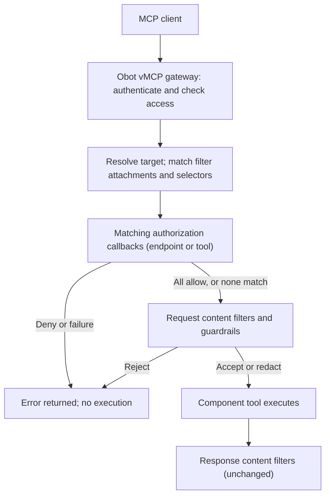

# 2026-10-09: AuthZEN authorization hook for MCP requests

- **Authors:** @cloudnautique
- **Created:** 2026-10-09

## Summary

Add an **authorization hook** to the MCP gateway's request pipeline. For each
matching client request, Obot calls the customer's AuthZEN policy service once,
before anything else happens: before content filtering, before the tool call,
and before response filtering. Obot supplies the authenticated identity and the
request target, and enforces the decision. A denial stops the request.

The hook is built on the existing filter framework, so it uses the same
attachments, selectors, transports (Webhook URL or MCP server), credentials, and
audit log. A filter can be authorization-only, or an existing content filter can
add an authorization callback so one service handles both.

No policy is installed by default. What the policy decides is up to the
customer: access rules by user and tool, approved-server lists, or, as one
example, per-user usage limits kept in the policy service.

## Related issues

- Obot tracking issue: **TBD**. One must be identified before review.
- [MCP ext-auth #14](https://github.com/modelcontextprotocol/ext-auth/issues/14)
  (AuthZEN for MCP) and [#15](https://github.com/modelcontextprotocol/ext-auth/issues/15)
  (COAZ parameter mapping) are design inputs, not dependencies.

## Related ODPs

- [Virtual MCPs](../2026-09-01-virtual-mcps/README.md): provides context for
  connection identity, attachment inheritance, and tool routing.
- [Local agent Filters](../2026-08-14-local-agent-filters/README.md): provides
  context for the existing filter contract, which this proposal preserves.

## Problem and motivation

Customers want to decide whether a particular caller may make a particular MCP
request, using their own policy logic and systems. Content filters can't support
that. Their payload is the raw MCP message, without the context an authorization
decision needs: who is calling, which server and operation they're targeting,
and the environment the call comes from. A policy service could only guess at
that context or reconstruct it from untrusted inputs.

Obot already knows that context when it authenticates and routes a request.
It should assemble it into a structured AuthZEN request (subject, action,
resource, and context) and enforce the decision. Customers should own the
policy logic.

### Why AuthZEN?

AuthZEN gives Obot a standard way to ask a policy service whether a request may
proceed, while customers choose their own policy engine. Its
[Authorization API 1.0](https://openid.net/wg/authzen/specifications/) is an
OpenID Foundation Final Specification. It also aligns with MCP's authorization
work: ext-auth #14 proposes AuthZEN for fine-grained MCP decisions, and COAZ
(#15, [COAZ-MCP draft](https://openid.github.io/authzen/authzen-coaz-mcp-binding-1_0.html))
maps MCP operations and parameters into those decisions. Using AuthZEN now
keeps a path to COAZ alignment without depending on draft work.

## Goals

- Add a distinct authorization stage that runs once per matching request, before
  content filtering and execution.
- Evaluate customer policies against identity established by Obot.
- Support authorization-only filters, and authorization alongside content
  filtering in one filter, over both Webhook URL and MCP transports.
- Reuse filter configuration, attachments, selectors, request processing, and
  audit storage instead of building a parallel system.
- Cover matching client requests across MCP methods, not only `tools/call`.
- Fail closed on denial or evaluation failure.
- Preserve existing content payloads, signing, mutation, and response contracts.

## Non-goals

A separate authorization resource or UI area, built-in policies, native rate
limiting (expected to land in the core product separately), decision caching or
retries, sending tool arguments or
configurable disclosure, verified agent identity or OBO delegation, and a new
audit store or filter-scoped audit view. COAZ conformance is not required.

## Context and constraints

- Users connect through a **vMCP**. Direct connections to component servers
  aren't a supported user flow.
- Filters already provide attachments, method/identifier selectors, encrypted
  credentials, enablement, and an ordered content pipeline. In-process guardrail
  filters remain content-only.
- An MCP-backed policy filter is invoked internally through existing filter
  runtime and session machinery. It does not create user-facing connections.
- A proof of concept on
  [`cloudnautique/obot@feature/authzen-filters`](https://github.com/cloudnautique/obot/tree/feature/authzen-filters)
  demonstrates the hook over webhooks. Its shortcuts, such as requiring a content
  endpoint, are POC details, not requirements of this design.

## Proposed design

### Request pipeline



- Authorization applies to client requests that have a JSON-RPC ID, including
  initialization, discovery, prompts, resources, and completion. It does not
  apply to notifications, server-originated messages, or responses.
- All matching authorization callbacks run sequentially, before any request
  content filter. Each filter is evaluated at most once per request, and the
  stage stops at the first denial or failure.
- For vMCP tool search, the existing resolver supplies the underlying tool name
  to both authorization and content filters.
- Once a request has been authorized, content filters may change argument values
  but not the method or the operation identifiers that were authorized. A
  violation is treated as an evaluation failure.

### Configuration

Authorization is configured as an `authorization` block on a filter's manifest,
in the existing filter form. It uses the filter's attachments, selectors, and
enablement. A filter needs at least one of a content callback or an
authorization callback.

Authorization-only webhook filter:

```json
{ "authorization": { "enabled": true, "url": "https://policy.example.com/access/v1/evaluation", "secret": "..." } }
```

MCP-backed filter that does both:

```json
{ "toolName": "filter_content", "authorization": { "enabled": true, "toolName": "authorize_request" } }
```

- Webhook authorization requires `url` and may set its own signing `secret`. MCP
  authorization requires `toolName`, which must differ from any content tool.
  Mixing URL and tool fields is rejected.
- Secrets are write-only and stored with the filter's encrypted credentials.
- Updates that omit `authorization` preserve it. Disabling requires an explicit
  `"enabled": false`, so older API clients can't silently remove enforcement.
- Changing a filter's type must revalidate its authorization binding, not drop it.

### Evaluation request

Obot builds the request from the authenticated session and resolved server
configuration. Clients cannot supply or override any field.

```json
{
  "subject":  {"type": "user", "id": "<obot-user-id>"},
  "action":   {"name": "tools/call", "properties": {"tool": "get_customer"}},
  "resource": {"type": "mcp-server", "id": "<server-id>"},
  "context":  {"obot": {"version": 1, "mapping": "obot-mcp-requests-v2",
               "authority": "https://obot.example.com", "evaluation_id": "<uuid>"}}
}
```

- `action.name` is the exact MCP method. `action.properties` carries only the
  operation identifier: tool or prompt name, resource URI, or completion
  reference and argument name. Discovery and other methods are method-only.
- `context.obot` may also include `catalog_id` and `catalog_entry_id` when the
  server configuration has them.
- Tool arguments, completion values, response content, groups, source IP, and
  headers are never included. Invalid operation identifiers fail closed.
- Agents using a user's credentials are evaluated as that user. Client-supplied
  agent or delegation claims are ignored.
- Mapping changes require a new `mapping` version.

The full method table is in the
[filters documentation](https://github.com/cloudnautique/obot/blob/feature/authzen-filters/docs/docs/functionality/filters.md#authzen-authorization).

### Decisions and failures

Both bindings use the same decision object and enforcement:

| Policy result | Client receives |
| --- | --- |
| `{"decision": true}` | Request continues to the next callback, then content filters. |
| `{"decision": false}` | HTTP 403. |
| Timeout, transport error, missing or invalid decision | HTTP 503. |

- Errors keep the JSON-RPC request ID and use gateway-generated messages. Policy
  service messages are never forwarded to clients.
- Each callback has a 5-second deadline, and the whole stage has 15 seconds.
  There are no retries and no decision caching.
- An allow decision means the request was admitted, not that it succeeded. A
  policy that counts usage counts attempts, including ones that content filters
  or the upstream server later reject.

### Webhook binding

Obot POSTs the evaluation request as JSON and expects HTTP 200 with the decision
object. Any other status is a failure. When a signing secret is configured, Obot
signs the body using the existing content-webhook convention
(`X-Obot-Signature-256`), with a separate secret. Without one, requests are
unsigned HTTPS. Callbacks use the gateway's restricted outbound transport and do
not follow redirects.

### MCP binding

Obot calls the authorization tool with the evaluation request as its `tools/call`
arguments. The tool must return the decision object in `structuredContent`,
without `isError`:

```json
{ "structuredContent": { "decision": true }, "isError": false }
```

Text-only output, `isError: true`, an unavailable runtime, and a missing tool all
fail closed. Free text is never interpreted as a decision. The call reuses the
existing filter runtime and session plumbing, with a separate decoder so the
content tool's accept/mutate contract is unaffected. Policy-tool calls run in a
trusted internal context that is not itself subject to customer authorization.

This is an Obot binding of the AuthZEN request to an MCP tool; AuthZEN does not
define an MCP tool interface.

### Audit

Each evaluation adds an `authorization` entry to the protected request's existing
MCP audit event. The entry records the filter ID, evaluation ID, mapping version,
result (`allow`, `deny`, or `error`), and duration. No new store or retention
policy is introduced.

## Alternatives considered

### Leave identity-aware policy to content filters

Content filters don't receive trusted identity, so this doesn't meet the need.

### Add identity to every content-filter payload

This changes an established contract and discloses identity to every content
filter. A separate callback keeps identity-aware policy opt-in.

### Separate authorization resource and UI

This would duplicate attachments, selectors, credentials, and lifecycle controls.
Building the hook on filters reuses all of them, and lets one service handle
both authorization and content filtering when a customer wants that.

### Webhooks only

This is simpler, but customers who run MCP-backed filters would need a second
service just for policy.

### Require COAZ

COAZ is still a draft. A versioned Obot mapping works today and leaves room to
align with COAZ later.

## Trade-offs

- Each matching request waits on an external call and depends on the policy
  service being available. Failing closed favors safety over availability.
- Sending only operation identifiers limits disclosure, but policies can't depend
  on argument values. For example, a policy can't restrict a GitHub tool to
  approved repositories when the repository is passed as an argument.
- Reusing selectors keeps configuration familiar, but inherits their coverage
  limits.

## Risks and open questions

- **vMCP resource identity (blocking).** Attachments and audit use the parent
  `vmcp...` ID, but the evaluation request carries the selected `vmcpi...`
  connection ID and no component identity. Policies can't target a parent vMCP.
  The mapping must be decided and versioned before rollout.
- **Rate-limit denials.** The POC lets a policy mark a denial as
  `rate_limited`, which Obot returns as HTTP 429 with `Retry-After`, and it
  counts 429s as denied in audit. Decide whether to keep that in this hook, or
  leave usage limits to the core product's planned rate limiting and return 403
  for every denial.
- **Rollback.** Older binaries ignore the authorization block, so downgrading
  silently removes enforcement. Decide whether a documented "disable first"
  procedure is enough or a startup guard is needed.
- **Disclosure.** Resource URIs and tool or prompt names are sent to the policy
  service and may themselves be sensitive.
- **Replay.** Signatures cover the body only and have no freshness guarantee.
  Receivers can deduplicate on `evaluation_id`; any freshness extension needs
  separate design.
- **Agent and OBO identity** need a separate design covering credential issuance
  and verification before they appear in the evaluation request.

## Rollout and migration

- Opt-in per filter; existing filters need no migration.
- Rollback means explicitly disabling authorization before downgrading, unless
  the rollback question above produces a guard.

## Testing and validation

- Contract tests shared by both bindings: allow, deny, each failure mode,
  deadlines, and the method mapping.
- Binding-specific tests. Webhook: signing and secret lifecycle. MCP:
  structured-only decisions, an unavailable runtime or missing tool, and no
  recursive evaluation.
- Pipeline tests: authorization runs before content, authorized identifiers
  can't be changed, older clients preserve configuration, and audit entries are
  recorded.
- Before release: test end to end through a real vMCP connection, and measure
  latency under load.

## References

- Proof of concept:
  [`cloudnautique/obot@feature/authzen-filters`](https://github.com/cloudnautique/obot/tree/feature/authzen-filters),
  including its draft [ADR](https://github.com/cloudnautique/obot/blob/feature/authzen-filters/adr/2026-10-11-authzen-authorization-filters.md),
  [filters documentation](https://github.com/cloudnautique/obot/blob/feature/authzen-filters/docs/docs/functionality/filters.md#authzen-authorization),
  and [demo receiver](https://github.com/cloudnautique/obot/blob/feature/authzen-filters/tools/authzen-demo/README.md).
- [AuthZEN specifications](https://openid.net/wg/authzen/specifications/).
