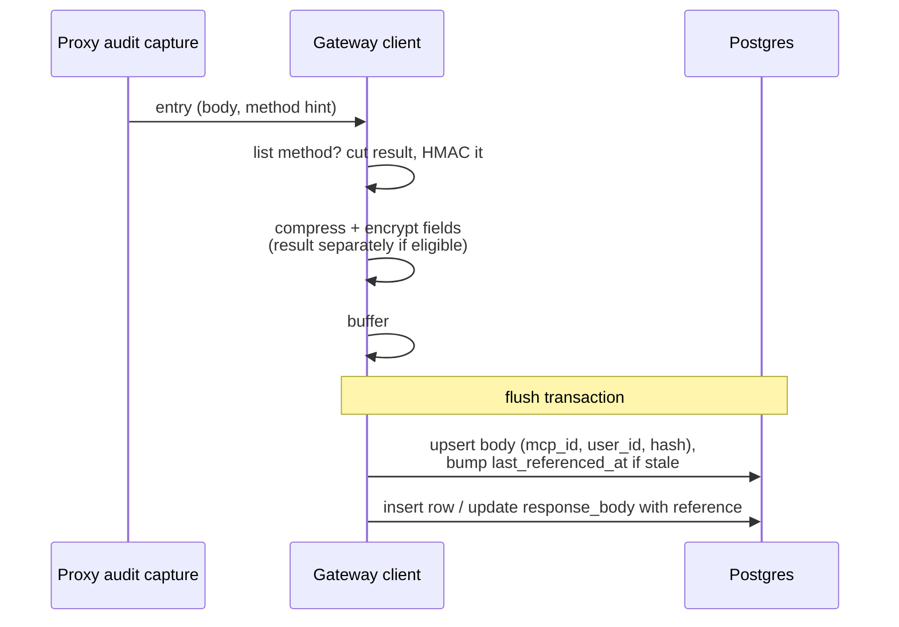

# 2026-11-10: Deduplicate and compress MCP audit log bodies

- **Author**: @g-linville
- **Created**: 2026-11-10

## Summary

`mcp_audit_logs` comprises over 95% of the database in hosted environments, and most
of it is encrypted request and response bodies.

This proposal makes two changes to how MCP audit bodies are stored:

1. **Compression**: prior to encryption, every body field is zstd-compressed. A per-
   field header is included with the new format so existing rows continue to read correctly.
2. **Deduplicate list responses**: the result of a `tools/list`, `prompts/list`, `resources/list`,
   or `resources/templates/list` response is stored once per MCP server + user pair in a new table,
   keyed by a hash. The audit row keeps the JSON-RPC envelope and a reference. Readers rebuild the
   original bytes. List responses rarely change, so this should cut down on a lot of duplicate logs.

No modifications will be made to existing audit logs. Compression and deduplication will
apply only to new audit logs.

## Related issues

- [obot-platform/obot#8418](https://github.com/obot-platform/obot/issues/8418)
  — drives this proposal; this design follows the approach described there.
- [obot-platform/obot#8420](https://github.com/obot-platform/obot/issues/8420)
  — related but separate: local-agent events store each tool response twice.
  That fix is out of scope here and its savings add to these.

## Related ODPs

None.

## Problem and motivation

Audit logs are simply taking up way too much space in production environments,
and these are the obvious best first steps to mitigate that problem.

## Goals

- Substantially reduce stored bytes for MCP audit logs
- Keep existing API, UI, audit log export, and webhook behavior
- No effect on existing audit logs
- Retention removes stored `/list` bodies that are no longer referenced by any
  remaining audit logs

## Non-goals

- Backfilling or rewriting existing rows
- Implementing this for LLM audit logs or egress audit logs (though this could be
  done as a follow-up)
- Deduplicating anything other than `/list` responses, or sharing stored bodies across
  users or across MCP servers
- Reclaiming disk space already allocated to the `mcp_audit_logs` table
- Changing the information captured in audit logs, the retention period, or moving
  audit log bodies out of Postgres

## Context and constraints

Facts about the current implementation that shape the design:

- **Body columns.** `MCPAuditLogFields` has `RequestBody`,
  `MutatedRequestBody`, `ResponseBody`, and `OriginalResponseBody`;
  `LocalAgentToolCallAuditLogFields` has `RequestBody`, `ResponseBody`, and
  `RawEvent`. All are `json.RawMessage`, stored as `bytea` on Postgres. SQLite
  is also supported.
- **The JSON-RPC envelope differs per call.** A stored response is the whole
  message, `{"jsonrpc":"2.0","id":7,"result":{…}}`. The `id` varies, so whole
  bodies are rarely identical even when the `result` is.
- **Two-step writes.** MCP entries are encrypted in `LogMCPAuditEntry`,
  buffered, and flushed in a transaction by `insertMCPAuditLogs`. A response
  often arrives as a separate entry with `CallType: "response"`; persistence
  finds the pending request row (`SELECT … FOR UPDATE`) and sets
  `response_body` with an `UPDATE`. The request row and the response update can
  come from different replicas, and during an upgrade from different versions.
- **Reads.** List queries omit body columns unless payloads are requested.
  `GetMCPAuditLog` (detail view) and `GetMCPAuditLogs` with payloads (API and
  the audit log export controller) decrypt bodies. Search does not look inside
  bodies. Webhook payloads are built at capture time, before persistence.
- **Body sizes.** Request bodies are capped at 10 MiB and a local-agent
  submission at 8 MiB for the whole batch. Response bodies have no reliable
  cap: plain JSON responses are limited to 10 MiB only when hooks run, and the
  audit capture buffers SSE events and hook-less responses without a limit.
- **Properties.** The gateway has a key/value `properties` table.
  `GetOrCreateProperty` encrypts the value with the configured transformer
  and stores plaintext when none is configured.

## Proposed design

### Field format

Each body field carries its own format marker. A row-level marker would not
work because the response `UPDATE` can be written by a different version than
the request `INSERT`.

A new-format field starts with a zero byte, which can never begin valid JSON
or base64, followed by a version and flags:

```text
byte 0   0x00          marker
byte 1   0x01          format version
byte 2   flags         bit 0: zstd-compressed
                       bit 1: encrypted
                       bit 2: reference to a stored body
rest     payload       raw bytes (no base64)
```

- A field without the marker is read exactly as today, using the row's
  `encrypted` flag.
- Writers compress, then encrypt with the existing transformer and the
  existing context, using zstd at its default level.
- A body is compressed only when it is at least 256 bytes and at most 64 MiB,
  and only when the compressed form is smaller. Otherwise the compressed flag
  is unset and the body is stored as is (still encrypted).
- New-format payloads are raw bytes. Today's base64 wrapping adds about 33%
  to every encrypted body for no benefit in a `bytea` column.
- Readers refuse to decompress a field to more than 64 MiB, so a corrupt
  field cannot exhaust memory. Because writers never compress a larger body,
  the cap can never reject a valid field, whatever the capture path produces.
- The format applies to all seven body columns listed above. Headers and the
  encrypted local-agent string fields are small and keep today's format. The
  row's `encrypted` flag keeps its meaning for those.

Exact byte layout is illustrative; the per-field marker, version, and flags
are the design.

### Stored list bodies

A new table holds each distinct list `result` once per MCP server and user:

```text
mcp_audit_log_bodies
  id                  primary key
  mcp_id              text
  user_id             text
  hash                bytea     HMAC-SHA256 of the plaintext result bytes
  body                bytea     field format above (compressed, then encrypted)
  created_at          timestamp
  last_referenced_at  timestamp, indexed
  unique (mcp_id, user_id, hash)
```

- **Scope is per MCP server and user.** The stored body is encrypted with the
  same `mcpauditlogs/<mcpID>/<userID>` context as the rows that reference it,
  so the encryption binding is exactly today's and nothing is shared or
  revealed across users.
- **Eligible bodies.** `ResponseBody` and `OriginalResponseBody` of the four
  list methods, when the body parses as a JSON-RPC success response with a
  `result` of at least 2 KiB. Postgres keeps values below about 2 KB in the
  main row, so a smaller result saves little and the reference still costs a
  hash, an envelope, and an index lookup. Everything else, including error responses
  and bodies that do not parse, is stored inline (compressed).
- **Knowing the method.** A separate response entry does not carry the request
  method. The proxy audit capture, which does know it for the same HTTP
  exchange, passes it as a non-persisted hint. Responses without a hint
  (legacy cross-request correlation) are stored inline.
- **Byte-exact rebuild.** The writer cuts the `result` value's bytes out of
  the body. The audit field becomes a reference record: the hash, the cut
  offset, and the remaining envelope bytes, encoded with the field format and
  the reference flag. The reader splices the stored bytes back at the offset,
  reproducing the original body exactly. No JSON canonicalization is done;
  two results that differ only in formatting are stored separately.
- **Rows reference bodies by hash, not by id**, so a body that is cleaned up
  and later re-created is still found.

### Hash key

The hash is `HMAC-SHA256` under a random 32-byte key. The key is generated on
the first eligible write and stored base64-encoded in the existing
`properties` table through `GetOrCreateProperty`, under a key such as
`mcp-audit-log-body-hash-key`. That path already encrypts the value when a
transformer is configured and stores plaintext otherwise, so encrypted and
unencrypted installs share one code path. Each replica caches the key in
memory.

A keyed hash prevents someone with database access from confirming a guessed
list body. The key is needed only to find an existing copy at write time. If
it is lost or replaced, new writes miss the old copies and store new ones;
reads are unaffected.

### Write path



- The stored-body upsert and the audit row write happen in the same
  transaction, so a committed row never references a body that was not
  written.
- The upsert is `INSERT … ON CONFLICT (mcp_id, user_id, hash) DO UPDATE SET
  last_referenced_at = …`, applied only when the body is absent or its
  `last_referenced_at` is more than a day old. A fresh existing body costs one
  indexed lookup and no write.
- A small in-process cache of recently confirmed keys lets a replica skip
  compressing and encrypting a result it already knows is stored. On a cache
  miss that turns out to be a conflict, the extra work is discarded.

### Read path

- Fields are decoded by marker: old-format fields as today; new-format fields
  are decrypted (if flagged), then decompressed (if flagged).
- For reference fields, the reader collects the distinct `(mcp_id, user_id,
  hash)` keys in the page, fetches them in one query, and splices each result
  into its envelope. A page of identical `tools/list` rows fetches one body.
- Queries that omit body columns (list views without payloads) never touch
  the new table.
- **Failures.** If a field or its stored body is missing, or fails to decrypt
  or decompress, the reader returns the row with its metadata, omits that
  body, lists it in a new `unavailablePayloads` field, and logs an error. One
  bad row does not fail a list page or an export run.
- **`unavailablePayloads`** is an additive string list on `AuditLogDetails`,
  next to `payloadRedacted`, naming each body that could not be read, for
  example `["response.body", "rawEvent"]`. It is omitted when empty. It sits
  on `AuditLogDetails` rather than `AuditLogPayloadDetails` so one list also
  covers `rawEvent`. The same type backs the JSONL export. The UI shows a
  notice in the detail view when the list is non-empty.
- Old-format decrypt errors keep today's behavior.

### Retention cleanup

After deleting expired audit rows, each replica deletes stored bodies whose
`last_referenced_at` is older than the retention cutoff minus a two-day
margin, in batches.

Why this is safe without counting references:

- Retention is the only thing that deletes audit rows, and it deletes by
  `created_at`.
- A row is always written at or after its `created_at`, and the write leaves
  the body's `last_referenced_at` no more than a day older than the write.
- So any surviving row (`created_at` ≥ cutoff) references a body whose
  `last_referenced_at` is within a day of the cutoff or newer, which the
  margin keeps. The second day of margin absorbs clock skew between replicas.

Concurrent writers and cleaners: a body old enough to delete is also stale,
so a writer referencing it must bump it. Either the delete commits first and
the writer's upsert re-inserts the body, or the writer's update holds the row
lock, and the delete re-checks its condition after the lock is released and
skips the row (Postgres `READ COMMITTED`). SQLite has a single writer.

If retention is disabled, stored bodies are never deleted.

## Alternatives considered

### Rely on Postgres compression

Would require storing bodies unencrypted, or encrypting below the database.
That weakens the at-rest guarantee for installs that configured a KMS
provider and still stores every copy.

### Deterministic (convergent) encryption

Encrypting identical plaintext to identical ciphertext would let equal bodies
be detected, but Postgres still would not share TOAST values between rows, and
the KMS-backed transformers do not offer it.

### Share stored bodies per MCP server (and not per user)

MCP servers might return different tool, resource, etc. lists based on the
user using the MCP server, so this is not an option.

### Row-level format column

Simpler to inspect, but wrong when the request insert and the response update
come from different versions.

## Trade-offs

- **Reads of deduplicated rows need a second query.** Batched per page, and
  only when payloads are requested.
- **Compress-then-encrypt makes ciphertext length depend on content.** This
  is data at rest with no attacker-chosen plaintext alongside secrets, so the
  practical exposure is that sizes hint at compressibility.
- **CPU.** Compression and HMAC are added to the capture path. Expected to be
  small relative to encryption and the proxy round trip.

## Risks and open questions

None.

## Rollout and migration

- **Schema.** One new table and index through the existing auto-migration.
  No change to `mcp_audit_logs` columns.
- **One release, on by default, no setting.** Readers and writers ship
  together.
- **No backfill.** Old rows stay in the old format and expire through
  retention. Storage for existing environments falls over the retention
  period (90 days by default).
- **Rolling upgrade.** New replicas read both formats. Old replicas cannot
  read fields written by new replicas: until every replica is upgraded,
  requests for payloads that hit an old replica fail for new rows. Metadata
  list views are unaffected, and nothing is lost.
- **Rollback.** Rolling back leaves rows written in the meantime unreadable
  (payloads only) until the upgrade is reapplied. The stored data remains
  intact.
- **Disk space.** Postgres reuses space freed by retention but does not
  return it to the operating system. Existing tables stop growing and then
  hold steady at their current allocation unless an operator runs
  `VACUUM FULL` or `pg_repack`. Whether we do this for hosted environments is
  an operations decision outside this proposal.

## Testing and validation

Unit tests:

- Write and read round trip for every body field, encrypted and unencrypted.
- Two identical `tools/list` results with different JSON-RPC ids are stored
  once and each row reads back byte-identical to its original body.
- The same result for two users, or two servers, is stored separately.
- Reading rows in the old format, and rows mixing old and new fields (old
  request, new response).
- Non-list methods, error responses, unparseable bodies, and responses
  without a method hint are stored inline.
- Missing or corrupt stored body returns the row with the body flagged.
- Cleanup deletes bodies nothing references and keeps bodies referenced by
  surviving rows, including at the margin.
- Loss of the hash key causes a new copy, not a read failure.

Integration tests (Postgres):

- A writer referencing a stale body concurrently with cleanup never commits a
  row whose body is missing.
- Several writers inserting the same new body concurrently produce one row.

Benchmark:

- Bytes stored for N repeated ~500 KB `tools/list` responses, before and
  after, and CPU time per entry.
- Compression ratio and CPU time for representative local-agent events.

## References

- [obot-platform/obot#8418](https://github.com/obot-platform/obot/issues/8418)
- [obot-platform/obot#8420](https://github.com/obot-platform/obot/issues/8420)
- Capture: `pkg/api/handlers/mcpgateway/proxy_audit.go`
- Write, encryption, read: `pkg/gateway/client/mcpauditlog.go`,
  `pkg/gateway/client/auditlogpersister.go`
- Retention: `pkg/gateway/client/retention.go`
- Types: `pkg/gateway/types/mcpauditlog.go`, `pkg/mcp/auditlogs/auditlog.go`
- Migrations: `pkg/gateway/db`
